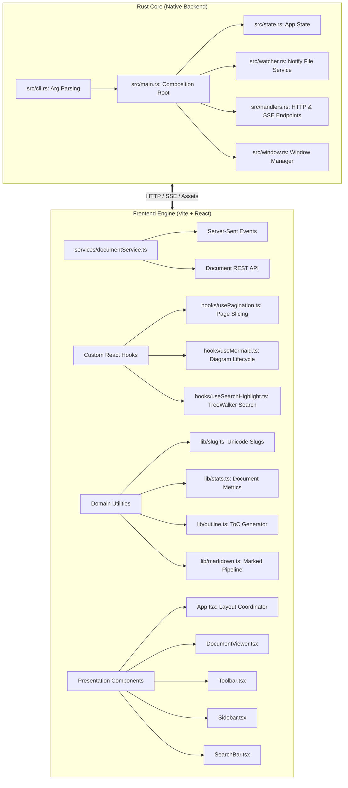

# Markdown Viewer 📖

> A publication-grade, PDF-style Markdown reader built with a high-performance **Rust** core and modern web typography engine. Designed specifically for Ubuntu and Linux desktop environments.

[](https://www.rust-lang.org/)
[](https://react.dev/)
[](https://www.typescriptlang.org/)
[](https://vitejs.dev/)
[](https://tailwindcss.com/)
[](LICENSE)
[](https://ubuntu.com/)
[](https://deepmind.google/technologies/gemini/)

---

## 📑 Table of Contents

- [Overview](#-overview)
- [Key Features](#-key-features)
- [Software Architecture & SOLID Principles](#-software-architecture--solid-principles)
- [🤖 Developed 100% with AI](#-developed-100-with-ai)
- [Quick Start](#-quick-start)
- [Ubuntu Desktop Integration](#-ubuntu-desktop-integration)
- [Keyboard Shortcuts](#-keyboard-shortcuts)
- [Themes & Typography](#-themes--typography)
- [Project Structure](#-project-structure)
- [License](#-license)

---

## 🌟 Overview

Most Markdown viewers display raw formatting symbols (`#`, `**`, `*`, `~~`, backticks, HTML tags), cluttering the reading experience. Others feel like code editors or require heavy, slow electron runtimes consuming hundreds of megabytes of RAM.

**Markdown Viewer** bridges this gap by delivering a **true PDF-style reading experience**:
- Physical paper sheets with realistic page drop-shadows, margins, running headers, and running footers.
- Zero raw formatting characters visible to the reader.
- Sub-15ms startup latency and only ~8.8MB native ELF binary size.
- Pure Rust HTTP & SSE backend with zero heavyweight GTK/WebKit dev dependency requirements.

---

## 🎯 Key Features

### 📄 Publication-Grade PDF Layout
- **Paged Sheet Mode**: Partition documents into virtual A4/Letter paper sheets with running headers ("Document Title | Section N") and running footers ("Page X of Y").
- **Continuous Reading Mode**: Center-aligned flow mode for long-form reading.
- **Accurate Zoom Controls**: Zoom from 50% to 200% with smooth transitions, or instant `100%` / `Fit Width`.
- **Print & PDF Export (`Ctrl+P`)**: High-fidelity `@media print` stylesheets that hide toolbars and export clean vector pages.

### 🧹 Clean Typography & Zero Syntax Leaking
- **No Raw Markdown Noise**: All symbols (`#`, `**`, `~~`, `_`, backticks) are completely parsed into publication-grade typography.
- **Academic Footnotes**: Full support for inline footnote references `[^1]` and definitions `[^1]: ...` with backlink navigation.
- **KaTeX Mathematical Typesetting**: Crisp rendering for both inline ($E=mc^2$) and multi-line display equations ($\int_{-\infty}^{\infty} e^{-x^2} dx$).
- **Syntax Highlighting**: Over 180 programming languages supported via Highlight.js, complete with language badges and one-click **Copy Code** button.
- **Interactive Mermaid Diagrams**: Native SVG generation for flowcharts, sequence diagrams, state machines, and entity-relationship charts without syntax corruption.
- **GitHub Callout Alerts**: Full rendering for `> [!NOTE]`, `> [!TIP]`, `> [!IMPORTANT]`, `> [!WARNING]`, and `> [!CAUTION]`.
- **Relative Local Images**: Automatically resolves relative file paths (e.g. ``) relative to the active document directory.
- **Task Checklists**: Stylized interactive checkboxes for `- [ ]` and `- [x]`.

### 🧭 Navigation & Document Insights
- **Outline Sidebar (`Ctrl+\`)**: Hierarchical Table of Contents (H1–H6) with smooth scrolling to sections and Unicode-resilient anchor links.
- **In-Document Search (`Ctrl+F`)**: Floating search widget with real-time text highlight markers and next/previous match navigation.
- **Live Document Metrics**: Instant calculation of total words, characters, estimated reading time, section count, file size, and last modified timestamp.
- **Live File Watcher**: Native background monitoring via the Rust `notify` crate, automatically reloading via Server-Sent Events (SSE) whenever changes are saved to disk.

---

## 🏛 Software Architecture & SOLID Principles

The project was refactored and structured following the **SOLID Principles** of Object-Oriented and Modular Software Design:



### 1. Single Responsibility Principle (SRP)
- **Rust Backend**:
  - `src/cli.rs`: Strictly parses and validates CLI arguments.
  - `src/watcher.rs`: Solely responsible for monitoring filesystem modifications on disk and broadcasting events.
  - `src/handlers.rs`: Only handles HTTP request routing, raw asset serving, and SSE streaming.
  - `src/window.rs`: Encapsulates Chrome/Chromium `--app` mode and fallback browser spawning.
  - `src/main.rs`: Acts purely as a composition root (<70 lines).
- **Frontend**:
  - `web/src/services/documentService.ts`: Isolates all remote API calls and SSE subscriptions.
  - `web/src/lib/slug.ts`: Handles Unicode-safe anchor slugification.
  - `web/src/lib/stats.ts`: Calculates word counts, characters, and reading time.
  - `web/src/lib/outline.ts`: Extracts heading hierarchies without touching rendering logic.
  - `web/src/hooks/useMermaid.ts`: Manages Mermaid initialization and DOM injection.
  - `web/src/hooks/useSearchHighlight.ts`: Manages TreeWalker DOM text traversal and highlighting.
  - `web/src/hooks/usePagination.ts`: Measures element heights offscreen to calculate virtual A4/Letter sheets.

### 2. Open-Closed Principle (OCP)
- The markdown processing pipeline in `web/src/lib/markdown.ts` uses Marked extensions (`markedKatex`, `markedFootnote`, custom renderers), allowing new syntax plugins to be registered without altering core parsing mechanics.
- Themes and font configurations are decoupled into CSS variables and Tailwind theme classes, making new visual themes trivial to add without modifying component logic.

### 3. Liskov Substitution Principle (LSP)
- View modes (`paged` vs `continuous`) share identical document and styling contracts.
- Browser window launch strategies (`ChromeAppModeLauncher`, `DefaultBrowserLauncher`) share a unified dispatch interface in `src/window.rs`.

### 4. Interface Segregation Principle (ISP)
- TypeScript interfaces (`DocumentMetadata`, `OutlineItem`, `ViewerSettings`, `SearchState`) are fine-grained; components only receive the exact slice of state they require rather than a monolithic context object.

### 5. Dependency Inversion Principle (DIP)
- The presentation component `DocumentViewer.tsx` depends on high-level hook abstractions (`usePagination`, `useMermaid`, `useSearchHighlight`) rather than concrete third-party libraries (`mermaid`, raw TreeWalker APIs, or DOM measurement logic).

---

## 🤖 Developed 100% with AI

> **Attribution Notice**: This entire project—architecture, code, bug fixes, refactoring, documentation, and packaging—was designed and written **100% by Artificial Intelligence**.

- **Primary AI Agent**: [Google Antigravity](https://deepmind.google/technologies/gemini/)
- **Core Reasoning Model**: **Gemini 3.8 Flash High**
- **Human Role**: Prompting, requirements clarification, feedback, and verification.

### Detailed AI Implementation Log:
1. **System Architecture Design**:
   - Evaluated native GUI alternatives (Tauri, WebKitGTK, Electron). Selected a lightweight, zero-dependency native approach: an optimized **Rust Axum + Tokio** daemon bundling a **React 19 + Vite** SPA via `rust-embed`, rendering in an isolated native `--app` window (`google-chrome --app=http://...` or `chromium`).
   - Achieved an 8.8MB binary that runs instantly on any standard Ubuntu installation without requiring `sudo` or development headers (`libwebkit2gtk-dev`).
2. **Typography & Parser Engineering**:
   - Engineered the AST transformations to completely strip raw markdown characters while preserving semantic HTML.
   - Solved syntax-highlighting double-escaping bugs (preventing `<span class="hljs...">` from leaking as raw text).
   - Resolved Mermaid diagram rendering issues by bypassing problematic regex sanitizers and directly invoking the native SVG engine.
   - Integrated academic footnotes (`marked-footnote`) and KaTeX mathematical notation.
3. **Desktop & Linux System Integration**:
   - Created the freedesktop-compliant `markdown-viewer.desktop` entry and `install.sh` script to provide seamless double-click file associations in Ubuntu Nautilus.
4. **Architectural Refactoring**:
   - Fully restructured both the Rust backend and the TypeScript frontend according to the SOLID principles to ensure readability, modularity, and high maintainability.

---

## 🚀 Quick Start

### Prerequisites
- Linux / Ubuntu (20.04, 22.04, 24.04+)
- [Rust & Cargo](https://rustup.rs/) (to build from source)
- [Node.js](https://nodejs.org/) and [`pnpm`](https://pnpm.io/) (for building the frontend)

### Build and Run from Source

```bash
# 1. Clone repository
git clone https://github.com/your-username/markdown-viewer.git
cd markdown-viewer

# 2. Build the web frontend
cd web
pnpm install
pnpm build
cd ..

# 3. Build the native Rust binary
cargo build --release

# 4. Run with a markdown file
./target/release/markdown-viewer examples/sample-showcase.md
```

---

## 📦 Ubuntu Desktop Integration

To install the viewer globally into your user environment (`~/.local/bin` and `~/.local/share/applications`):

```bash
./install.sh
```

### What the installer does:
1. Builds the release binary and copies it to `~/.local/bin/markdown-viewer`.
2. Installs high-resolution SVG desktop icons to `~/.local/share/icons/hicolor/scalable/apps/`.
3. Registers the `markdown-viewer.desktop` file with your desktop launcher and associates MIME types (`text/markdown`, `text/x-markdown`).

You can now:
- Run `markdown-viewer <file.md>` from any directory in your terminal.
- Right-click any `.md` file in **Files (Nautilus)** -> **Open With...** -> **Markdown Viewer**.

---

## ⌨️ Keyboard Shortcuts

| Shortcut | Description |
| :--- | :--- |
| <kbd>Ctrl</kbd> + <kbd>O</kbd> | Open File dialog |
| <kbd>Ctrl</kbd> + <kbd>F</kbd> | Toggle in-document search |
| <kbd>Ctrl</kbd> + <kbd>P</kbd> | Print or Export to high-resolution PDF |
| <kbd>Ctrl</kbd> + <kbd>\</kbd> | Toggle Table of Contents / Outline sidebar |
| <kbd>Ctrl</kbd> + <kbd>+</kbd> | Zoom in (+10%) |
| <kbd>Ctrl</kbd> + <kbd>-</kbd> | Zoom out (-10%) |
| <kbd>Ctrl</kbd> + <kbd>0</kbd> | Reset zoom to 100% |
| <kbd>PageDown</kbd> | Next page (Paged Sheets mode) |
| <kbd>PageUp</kbd> | Previous page (Paged Sheets mode) |
| <kbd>Enter</kbd> (in Search) | Next search match |
| <kbd>Shift</kbd> + <kbd>Enter</kbd> | Previous search match |
| <kbd>Esc</kbd> | Close search bar |

---

## 🎨 Themes & Typography

### Themes
- **Paper White**: Crisp, high-contrast, pure document surface for daylight reading.
- **Warm Sepia**: Editorial paper tone, gentle on the eyes for extended reading sessions.
- **Slate Gray**: Modern dark mode with balanced contrast.
- **Obsidian Dark**: Deep OLED black tone for low-light environments.

### Typography
- **Clean Sans**: High legibility for technical documentation (system UI font stack).
- **Editorial Serif**: Elegant serif typeface for literature, essays, and academic papers.
- **Monospace**: Clean monospace typeface for code specifications.
- **Adjustable Size**: Live font-size scaling from 13px to 22px.

---

## 📁 Project Structure

```
markdown-viewer/
├── Cargo.toml                  # Rust workspace & dependencies
├── Cargo.lock
├── LICENSE                     # MIT License
├── README.md                   # Project documentation & AI disclosure
├── install.sh                  # Global installer for Ubuntu / Linux
├── markdown-viewer.desktop      # Freedesktop application entry
├── assets/
│   └── icon.svg                # Vector desktop application icon
├── bin/
│   └── markdown-viewer         # Local launcher script
├── examples/
│   └── sample-showcase.md      # Comprehensive feature test document
├── src/                        # Rust Core (Backend Daemon)
│   ├── main.rs                 # Composition root & async runtime setup
│   ├── cli.rs                  # Clap CLI arguments parsing
│   ├── state.rs                # Shared application state & types
│   ├── watcher.rs              # Notify file watcher & event broadcasting
│   ├── handlers.rs             # Axum handlers (REST, SSE, Embedded Assets)
│   └── window.rs               # Standalone window launcher (Chrome/Chromium app mode)
└── web/                        # Frontend Engine (Vite + React)
    ├── package.json            # Managed with pnpm
    ├── vite.config.ts          # Bundler configuration
    ├── tailwind.config.js      # Palette and typography theme settings
    └── src/
        ├── main.tsx            # React entrypoint
        ├── App.tsx             # Root layout & shortcut coordinator
        ├── types.ts            # Type definitions & domain interfaces
        ├── services/
        │   └── documentService.ts # API client & SSE subscriber
        ├── hooks/
        │   ├── useMermaid.ts   # Mermaid diagram rendering hook
        │   ├── useSearchHighlight.ts # TreeWalker DOM text search hook
        │   └── usePagination.ts# PDF sheet measurement and slicing hook
        ├── lib/
        │   ├── slug.ts         # Unicode-resilient slug generator
        │   ├── stats.ts        # Word/character count & reading time
        │   ├── outline.ts      # Table of Contents extractor
        │   └── markdown.ts     # Marked rendering pipeline & extensions
        ├── components/
        │   ├── Toolbar.tsx     # PDF viewer navigation & settings bar
        │   ├── Sidebar.tsx     # Outline & document metadata sidebar
        │   ├── DocumentViewer.tsx # Publication-grade document surface
        │   └── SearchBar.tsx   # Floating search bar
        └── styles/
            └── globals.css     # PDF page sheet styles, KaTeX, & @media print
```

---

## 📄 License

This project is open-source under the [MIT License](LICENSE).
Feel free to use, modify, and distribute it freely.
