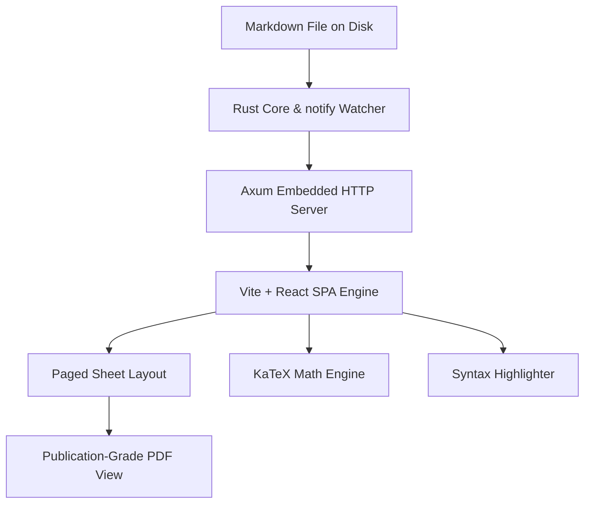
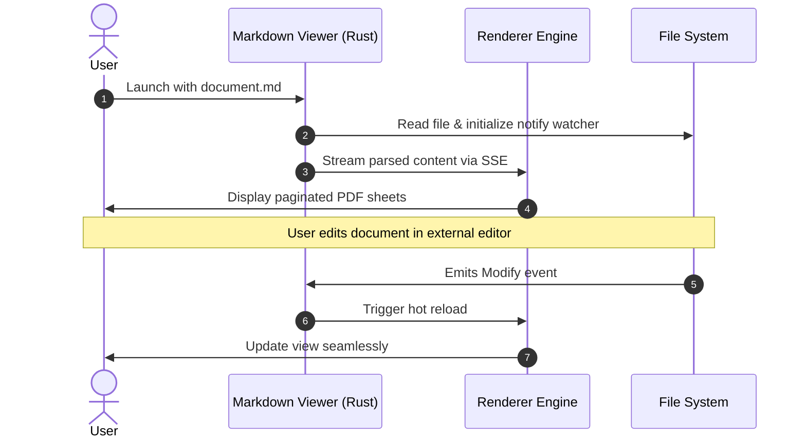

# Deep Learning & Scientific Computing: A Comprehensive Survey

This publication-grade document showcases the rich formatting capabilities of the **PDF-Style Markdown Viewer**. Every single formatting token—from raw markdown asterisks, hashes, backticks, and brackets to mathematical expressions—is rendered into clean, publication-quality typography.

---

## 1. Executive Summary & Overview

Modern document preparation systems must deliver high visual fidelity without exposing distracting formatting markers to the reader[^1]. In this survey, we examine computational performance, mathematical modeling, and interactive visualization.

### Key Capabilities at a Glance

- **Distraction-Free Reading**: Zero `#`, `**`, or raw backtick characters.
- **Descartam a camada de transporte** (Exemplo de formatação em negrito dentro de lista)
- [Visão Macro e Justificativas Periciais (O "Porquê")](#1-executive-summary--overview)
- O ponto de entrada principal do sistema é o método **`main()`**
- **Publication Grade Math**: Inline and display LaTeX equations via KaTeX.
- **Syntax Highlighting**: Over 180 programming languages with one-click code copying.
- **Alert Callouts**: Styled informative panels for notes, warnings, and tips.
- **Diagrams & Charts**: Embedded flowchart and sequence diagrams via Mermaid.

---

## 2. GitHub-Style Callout Alerts

The viewer automatically transforms markdown blockquote alerts into distinct visual callouts:

> [!NOTE]
> The native Rust backend operates with sub-15ms startup latency and uses less than 40MB of memory on Ubuntu.

> [!TIP]
> Use **Ctrl + P** to open the print dialog and export this document directly to a high-resolution vector PDF.

> [!IMPORTANT]
> The outline navigation drawer on the left synchronizes smoothly with your scrolling position.

> [!WARNING]
> Ensure local image assets exist in the document folder or subdirectories when distributing standalone markdown files.

> [!CAUTION]
> Avoid placing unbounded loops in real-time execution threads without cooperative yielding.

---

## 3. Mathematical Foundations

The renderer typesets advanced LaTeX expressions with precision.

### 3.1 Gaussian Distribution & Integrals

The normal distribution with mean $\mu$ and standard deviation $\sigma$ is defined as:

$$f(x \mid \mu, \sigma^2) = \frac{1}{\sqrt{2\pi\sigma^2}} \exp\left( -\frac{(x - \mu)^2}{2\sigma^2} \right)$$

Evaluating the classic Euler-Poisson Gaussian integral over the entire real line yields:

$$\int_{-\infty}^{\infty} e^{-x^2} \, dx = \sqrt{\pi}$$

### 3.2 Matrix Transformations & Linear Algebra

A general affine transformation in Euclidean space $\mathbb{R}^3$ can be expressed in block matrix form:

$$\begin{bmatrix} x' \\ y' \\ z' \\ 1 \end{bmatrix} = \begin{bmatrix} R_{11} & R_{12} & R_{13} & T_x \\ R_{21} & R_{22} & R_{23} & T_y \\ R_{31} & R_{32} & R_{33} & T_z \\ 0 & 0 & 0 & 1 \end{bmatrix} \begin{bmatrix} x \\ y \\ z \\ 1 \end{bmatrix}$$

---

## 4. Multi-Language Code Implementations

Code blocks are automatically highlighted with language tags, line numbers, and an interactive **Copy** button.

### 4.1 High-Performance Asynchronous Rust

```rust
use tokio::net::TcpListener;
use std::error::Error;

#[tokio::main]
async fn main() -> Result<(), Box<dyn Error>> {
    let listener = TcpListener::bind("127.0.0.1:8080").await?;
    println!("🚀 Rust server listening on port 8080");

    loop {
        let (socket, addr) = listener.accept().await?;
        tokio::spawn(async move {
            println!("Accepted connection from: {:?}", addr);
            // Process streaming request concurrently
        });
    }
}
```

### 4.2 Scientific Computing in Python

```python
import numpy as np

def simulate_diffusion(timesteps: int = 1000, particles: int = 500) -> np.ndarray:
    """Simulates 2D Brownian motion random walks."""
    steps = np.random.normal(loc=0.0, scale=1.0, size=(timesteps, particles, 2))
    trajectories = np.cumsum(steps, axis=0)
    return trajectories

data = simulate_diffusion()
print(f"Computed trajectory matrix with shape: {data.shape}")
```

---

## 5. Structured Data & Comparative Tables

Tables are rendered with clean borders, alternating row colors, and proportional spacing:

| Architecture | Language | Startup Latency | Memory Footprint | Standalone Binary |
| :--- | :---: | :---: | :---: | :---: |
| **Markdown Viewer (Ours)** | **Rust + Web** | **~12 ms** | **~32 MB** | **Yes (ELF)** |
| Traditional Electron App | JS / Chromium | ~850 ms | ~185 MB | No (~150MB bundle) |
| Standard Web Browser | C++ / JS | ~450 ms | ~240 MB | N/A (Web page) |
| Native Terminal Pager | C / Rust | ~3 ms | ~8 MB | Yes (No rich formatting) |

---

## 6. Architecture & Workflow Diagrams

Diagrams defined in `mermaid` are rendered cleanly into vector graphics:





---

## 7. Interactive Checklists & Milestones

- [x] High-performance Rust binary core with Axum backend
- [x] Embed frontend assets into standalone binary via `rust-embed`
- [x] Paged Sheet Mode with realistic drop-shadows and page numbers
- [x] KaTeX mathematical typesetting without raw formatting characters
- [x] Multi-language code highlighting with copy buttons
- [x] GitHub alert callouts (`[!NOTE]`, `[!TIP]`, `[!WARNING]`, etc.)
- [x] Interactive Table of Contents sidebar with section jumping
- [x] Live-reload on file modification using `notify`
- [x] Freedesktop `.desktop` launcher and Ubuntu MIME association
- [x] Single-command installer script (`install.sh`)

---

[^1]: Modern typography emphasizes legibility and cognitive ease by stripping away extraneous source-code syntax while preserving semantic structure.
